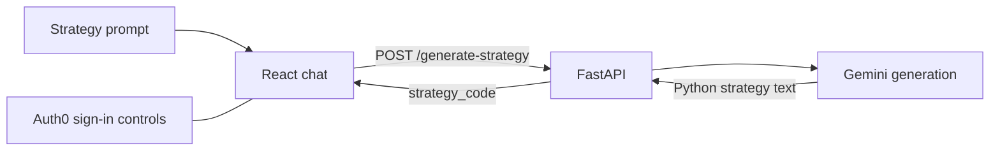

# FinTrack

**Turn a trading-strategy prompt into Python code through a conversational interface.**

FinTrack combines a React chat client with a FastAPI endpoint that asks Gemini to generate a Backtrader strategy. The client displays the returned code and keeps separate chat sessions in browser memory. This is a collaborative project prototype; the committed API generates code but does not run a backtest or report measured trading performance.

## How it works



The request is `{"user_input": "..."}`; the response contains `strategy_code` or `error`. [server.py](FinTrack-main/backend/server.py) calls the generator in [gemini.py](FinTrack-main/backend/gemini.py). Its prompt asks for buy/sell logic, an indicator, order management, trade logging, whole-share orders, and an initial capital of $100. These are requested generation constraints, not verified properties of every response.

[App.tsx](FinTrack-main/src/App.tsx) sends requests to a hardcoded hosted API URL. [main.tsx](FinTrack-main/src/main.tsx) supplies Auth0 settings and routes for the chat and About page. Login controls do not enforce authentication on the committed API endpoint.

## Repository layout

The application lives inside `FinTrack-main/`:

```text
FinTrack-main/
├── backend/
│   ├── server.py          FastAPI strategy-generation endpoint
│   ├── gemini.py          Gemini prompt and helper functions
│   └── requirements.txt   Backend dependencies
├── src/
│   ├── App.tsx            Sessions, requests, and chat layout
│   ├── main.tsx           Auth0 and routing
│   └── components/        Chat input, messages, About, and UI prototypes
├── public/                Logo and interface assets
└── package.json           Vite development/build scripts
```

The root also contains an archived ZIP; use the checked-in directory for development.

## Explore the frontend

Install Node.js and npm, then:

```bash
git clone https://github.com/sudhanvad18/FinTrack.git
cd FinTrack/FinTrack-main
npm ci
npm run dev
```

Open the URL Vite prints, normally `http://localhost:5173`. Sending a prompt uses the hosted backend configured in `src/App.tsx`, so generation depends on that service and its model configuration. Hosted availability has not been verified. Sessions reset on page reload.

To use your own Auth0 application, update the public domain/client ID in `src/main.tsx` and configure local callback/logout URLs in Auth0.

## Connect a local backend

The Python service requires configuration before use:

1. In `FinTrack-main/backend/gemini.py`, replace the literal `API_KEY` configuration with a read from your shell environment, for example `import os` and `API_KEY = os.environ["GEMINI_API_KEY"]`. The current source does not read that environment variable automatically.
2. Check the configured `MODEL_ID` against a model available to your account. The committed value is `models/gemini-2.0-flash`; this documentation refresh has not verified its availability.
3. Change the fetch URL in `FinTrack-main/src/App.tsx` to `http://localhost:8000/generate-strategy`. Local Vite origins on port 5173 are already listed in the backend's CORS settings.

From the repository root, prepare a Python environment and start the API:

```bash
cd FinTrack-main/backend
python3 -m venv .venv
source .venv/bin/activate
python -m pip install -r requirements.txt
# gemini.py also directly imports these packages:
python -m pip install pandas numpy

# Set GEMINI_API_KEY in this shell after making the configuration edit above.
python -m uvicorn server:app --reload --host 127.0.0.1 --port 8000
```

Keep the frontend running in a separate terminal. FastAPI's local API documentation is at `http://127.0.0.1:8000/docs`. Model calls require a configured account and may incur usage charges. Do not commit credentials.

## Scope and development status

- The active API returns generated strategy text. It does not fetch historical prices, execute a strategy, or calculate returns.
- `create_strategy_from_code` exists as a helper using Python `exec`, but the API route does not call it. Generated code requires review and a separate controlled execution environment.
- [Metrics.tsx](FinTrack-main/src/components/Metrics.tsx) contains placeholder chart/metric content and is not connected to the main chat. Its sample figures are not backtest results.
- [TextToCodeModel(1).py](FinTrack-main/src/TextToCodeModel%281%29.py) is a separate CUDA/LoRA training experiment using a DeepSeek model and a Stack Overflow Python dataset. The FastAPI route uses Gemini; it does not serve a trained DeepSeek checkpoint. Training dependencies are not supplied by the backend requirements file.
- No end-to-end recording, automated test suite, or measured strategy-quality results were verified for this repository.

Run frontend commands from `FinTrack-main/`:

| Command | Purpose |
| --- | --- |
| `npm run dev` | Start Vite. |
| `npm run build` | Type-check and build production assets. |
| `npm run preview` | Serve an existing build. |
| `npm run lint` | Run ESLint. |

These are declared project commands; the live repository source was reviewed without running its services, models, or build.

## Team

The [About page](FinTrack-main/src/components/AboutPage.tsx) credits Vishruth and Ronil for frontend work, and Kalyan, Sudhanva, and Navan for backend work. The source records the team's attribution; it does not establish individual implementation scope or measured outcomes.
